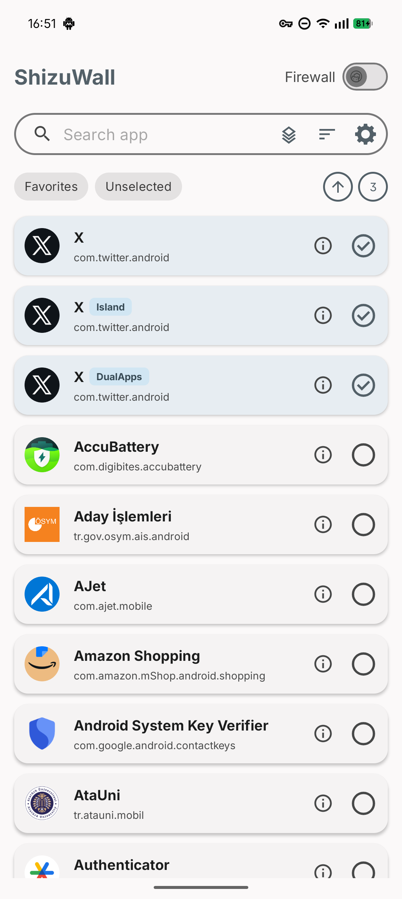

<div align="center">
  <a href="https://play.google.com/store/apps/details?id=com.arslan.shizuwall">
    
  </a>
  <h1>ShizuWall</h1>
  <strong>Android-Firewall ohne VPN.</strong><br/>
  Datenschutz zuerst, rein lokal, betrieben über Shizuku / lokalen ADB-Daemon / Root.
</div>

<p align="center">
  <a href="../README.md">English</a> ·
  <a href="README.tr.md">Türkçe</a> ·
  <b>Deutsch</b> ·
  <a href="README.it.md">Italiano</a> ·
  <a href="README.pt.md">Português</a> ·
  <a href="README.cs.md">Čeština</a> ·
  <a href="README.ru.md">Русский</a> ·
  <a href="README.ar.md">العربية</a> ·
  <a href="README.hi.md">हिन्दी</a> ·
  <a href="README.zh.md">中文</a> ·
  <a href="README.ja.md">日本語</a>
</p>
<div style="height: 20px;">&nbsp;</div>
<p align="center">
  <a href="https://tooomm.github.io/github-release-stats/?username=AhmetCanArslan&repository=ShizuWall">
    
  </a>
  
  
  
  
</p>

<p align="center">
  <a href="https://play.google.com/store/apps/details?id=com.arslan.shizuwall">
    
  </a>
  <a href="https://f-droid.org/packages/com.arslan.shizuwall/">
    
  </a>
</p>

<p align="center">
  <a href="https://www.buymeacoffee.com/ahmetcanarslan">
    
  </a>
</p>


## Funktioniert mit

Android 11+ und eines dieser Backends:

- **Shizuku** (Forks werden unterstützt)
- **LibADB**: koppelt über Wireless Debugging, ohne Computer
- **Root**

## Warum ShizuWall

- **Kein VPN**: kein Abfangen von Paketen, kein dauerhafter Tunnel.
- **Steuerung pro App**: sperrt den Netzwerkzugriff pro App, einschließlich Arbeitsprofil- und Klon-Kopien.
- **Privat**: Offline-first, keine Analysen, keine Telemetrie.
- **Schnellzugriff**: Schnelleinstellungs-Kachel, Widget und schwebende Schaltfläche.
- **Automatisierung**: steuerbar über Broadcasts aus adb, Tasker, MacroDroid und Ähnlichem.

## Screenshot

<p align="center">
  
</p>

## Funktionsweise

ShizuWall steuert Androids Connectivity-**Chain 3**, einen Plattformmechanismus, der den Netzwerkzugriff pro Paket regelt:

```bash
cmd connectivity set-chain3-enabled true                                # Firewall an
cmd connectivity set-package-networking-enabled false <package.name>   # sperren
cmd connectivity set-package-networking-enabled true <package.name>    # entsperren
cmd connectivity set-chain3-enabled false                               # Firewall aus
```

Android löscht diese Regeln beim Neustart.

## Automatisierung

Jeder Broadcast benötigt ein aktives Backend. `apps` ist eine CSV-Liste von App-Schlüsseln: Ein bloßer Paketname zielt auf Nutzer 0, ein Schlüssel mit Präfix wie `150:com.example.app` auf die Kopie in diesem Arbeitsprofil oder Klon-Bereich.

### Firewall: `shizuwall.CONTROL`

| Extra | Typ | |
|---|---|---|
| `state` | boolean, erforderlich | `true` = sperren, `false` = entsperren |
| `apps` | string, optional | Apps, die gesperrt oder entsperrt werden. Ohne dieses Extra schaltet der Broadcast die gesamte Firewall um. |

```bash
# Firewall einschalten (state false schaltet sie aus)
adb shell am broadcast -a shizuwall.CONTROL -n com.arslan.shizuwall/.receivers.FirewallControlReceiver --ez state true

# Eine App und ihre Arbeitsprofil-Kopie sperren
adb shell am broadcast -a shizuwall.CONTROL -n com.arslan.shizuwall/.receivers.FirewallControlReceiver --ez state true --es apps "com.example.app,150:com.example.app"
```

- Mit `apps` folgt die Auswahl in der App: `state true` wählt die Apps aus und schaltet die Firewall ein, falls sie aus war; `state false` wählt sie ab und lässt die Firewall an. Im Whitelist-Modus adressiert `apps` die Erlaubnisliste, die beiden Zustände sind also vertauscht.
- Ist **Apps in anderen Profilen anzeigen** aus, gilt ein bloßer Paketname auch für seine Klone. Ist es an, wird jedes Profil nur über sein Präfix adressiert.

### Neue App: `shizuwall.APP_INSTALLED`

Meldet eine neu installierte App, sodass Richtlinie und Benachrichtigung für neue Apps so angewendet werden, als hätte ShizuWall die Installation selbst erkannt. ShizuWall sieht nur Installationen im eigenen Profil; so lassen sich die anderen abdecken.

```bash
adb shell am broadcast -a shizuwall.APP_INSTALLED -n com.arslan.shizuwall/.receivers.AppInstalledReceiver --es apps "com.example.newapp"
```

Solange die Firewall aus ist, wird keine Regel angewendet. Apps ohne die Berechtigung `INTERNET` werden ignoriert.

### Profil: `shizuwall.PROFILE`

Aktiviert ein gespeichertes Profil: schreibt dessen App-Auswahl, Firewall-Modus, App-spezifische Modi und die Einstellung *System-Apps anzeigen*.

| Extra | Typ | |
|---|---|---|
| `profile` | string | Profilname, wie in der Profilübersicht angezeigt. |
| `profile_id` | string | Interne ID; wird zuerst geprüft und bleibt von Umbenennungen unberührt. Der Dialog **Automatisierung** des Profils zeigt den fertigen Befehl. |
| `force_enable` | boolean, optional | Schaltet die Firewall nach dem Wechsel ein, auch wenn sie aus war. |

Entweder `profile` oder `profile_id` ist erforderlich. Passt keines, ändert sich nichts und ein Toast meldet es.

```bash
adb shell am broadcast -a shizuwall.PROFILE -n com.arslan.shizuwall/.receivers.ProfileControlReceiver --es profile "Work"
```

## Haftungsausschluss

ShizuWall wird **„wie besehen“** ohne Gewährleistung bereitgestellt. Es nutzt weitreichende Systemberechtigungen; der Entwickler haftet nicht für Systeminstabilität, Datenverlust oder Nebenwirkungen blockierter Netzwerkzugriffe. Prüfe immer, welche Apps du blockierst.

**Offizielle Quellen sind nur Google Play, F-Droid und dieses Repository.** APKs von anderswo sind nicht zugehörig und werden auf eigenes Risiko verwendet.

`INTERNET` wird nur für das Koppeln über Wireless Debugging (LibADB) angefordert.

## Lizenz

[GPLv3](../LICENSE.md). Die mitgelieferten Tracker-Signaturdaten sind separat unter ODbL v1.0 lizenziert, siehe [TRACKER_DATA_LICENSE.md](../TRACKER_DATA_LICENSE.md).

## Danksagungen

- [Shizuku](https://github.com/RikkaApps/Shizuku): Ausführung privilegierter Befehle.
- [LibADB](https://github.com/MuntashirAkon/libadb-android): kabelloses Debugging und Daemon-Verbindung.
- [Exodus Privacy](https://exodus-privacy.eu.org/): Tracker-Signaturdatenbank. ShizuWall liefert eine gekürzte Kopie mit und kontaktiert deren API nie.
